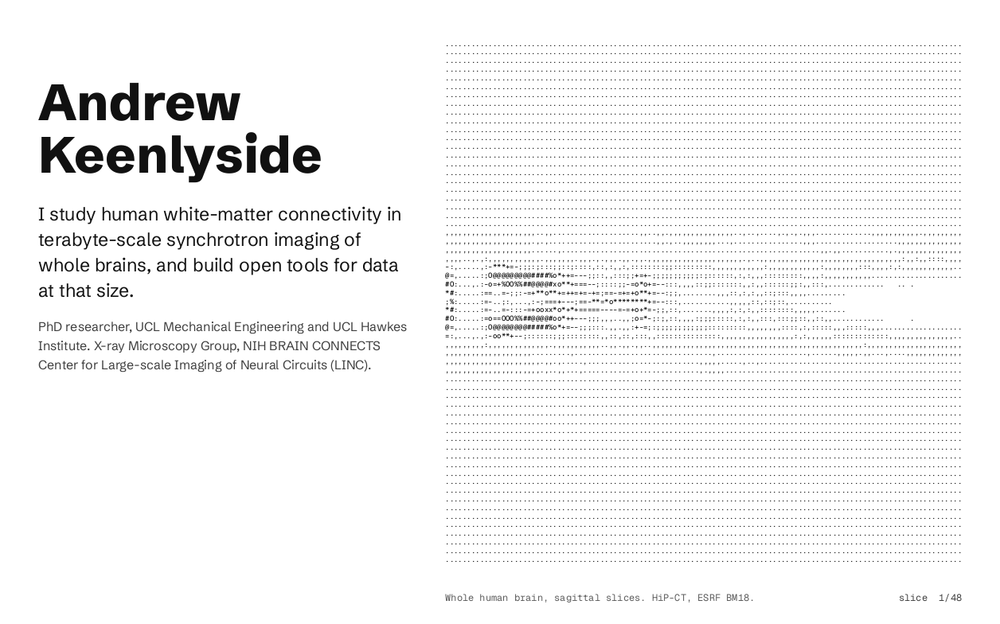

<a href="https://andrew-keenlyside.github.io">
  <picture>
    <source media="(prefers-color-scheme: dark)" srcset="assets/hero-dark.gif">
    
  </picture>
</a>

### Research

**Multiscale connectomics in terabyte-scale synchrotron imaging** 
PhD, 2024–. UCL Hawkes Institute and NIH BRAIN CONNECTS (LINC) 
White-matter connectivity in HiP-CT scans of whole human brains. → [BRIDGE](https://andrew-keenlyside.github.io/bridge/)

**Zarr Vectors** 
2026–, with the Allen Institute 
Chunked, multiscale storage for streamlines, graphs and meshes, so network analysis scales to terabyte-sized connectomes. → [zarr-vectors-py](https://github.com/AllenInstitute/zarr-vectors-py)

### Code & data

| | | |
|:--|:--|:--|
| `Python` | [**zarr-vectors-py**](https://github.com/AllenInstitute/zarr-vectors-py) | Chunked, multiscale streamlines, graphs and meshes |
| `Julia` | [**StructureTensor.jl**](https://github.com/Andrew-Keenlyside/StructureTensor.jl) | Structure tensor analysis of 3D volumes |
| `Python` | [**ChunkReg**](https://github.com/Andrew-Keenlyside/ChunkReg) | Chunked co-registration of large synchrotron datasets |
| `Spec` | [**zarr-octree**](https://github.com/Andrew-Keenlyside/zarr-octree) | A Zarr octree sharding codec |
| `Python` | [**zvDVC**](https://github.com/Andrew-Keenlyside/zvDVC) · [**zvCFD**](https://github.com/Andrew-Keenlyside/zvCFD) | Volume correlation and fluid dynamics on Zarr Vectors |
| `Data` | [**Synchrotron Reference Brain**](https://github.com/Andrew-Keenlyside/Synchrotron_Reference_Brain) | Cohort-averaged template, SRB2026a |
| `Data` | [**The Extremely Brilliant Brain**](https://doi.org/10.64898/2026.01.27.702076) | Isotropic microscale human brain dataset |

### Contact

[andrew-keenlyside.github.io](https://andrew-keenlyside.github.io) · [ORCID](https://orcid.org/0000-0002-6059-2103) · [andrew.keenlyside.23@ucl.ac.uk](mailto:andrew.keenlyside.23@ucl.ac.uk)

The brain is public HiP-CT data from the [Human Organ Atlas](https://human-organ-atlas.esrf.fr) (Human Organ Atlas Collaboration; ESRF beamline BM18), donor S-21-46, [doi:10.15151/ESRF-DC-2222698126](https://doi.org/10.15151/ESRF-DC-2222698126), licensed [CC BY 4.0](https://creativecommons.org/licenses/by/4.0/). Downsampled and rendered as text.
